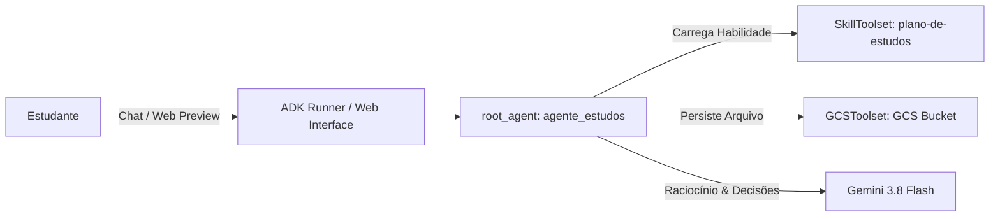
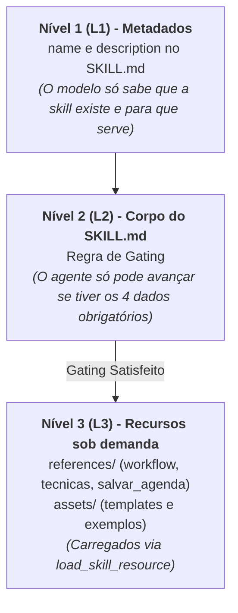

# Detalhamento Completo do Projeto: Agente de Estudos

Este guia foi elaborado para explicar **de ponta a ponta**, de maneira clara e didática, o funcionamento, a arquitetura e os conceitos fundamentais do **`agente-estudos`**.

---

## 1. O que é o Agente de Estudos?

O **`agente-estudos`** é um assistente de IA especialista em aprendizagem e organização de rotinas de estudo, desenvolvido com o **Google ADK (Agent Development Kit)** em Python.

Em vez de ser apenas um chatbot que dá respostas genéricas, o agente atua como um **mentor estruturado**:
1. Entrevista o estudante para entender suas metas e disponibilidade real.
2. Não gera nada até ter todas as informações essenciais (**Regra de Gating**).
3. Elabora um cronograma personalizado aplicando técnicas de neurociência e aprendizagem (como repetição espaçada e prática intercalada).
4. Exporta a agenda de sessões em formato **CSV compatível com o Google Agenda**.
5. Salva esse arquivo diretamente na nuvem utilizando o **Google Cloud Storage (GCS)**.
6. Permite replanejamento contínuo se o estudante atrasar ou perder sessões.

---

## 2. Pilares Tecnológicos

### 2.1 Google ADK (Agent Development Kit)
O **ADK** é o framework oficial do Google para construção de agentes autônomos em Python. Diferente de chamadas simples de API de LLM:
* **Gerencia o ciclo de vida:** Sessões, histórico e streaming de mensagens.
* **Orquestração de Ferramentas (Toolsets):** Conecta a IA a APIs externas, bancos de dados, serviços de nuvem e arquivos.
* **Suporte a Skills:** Permite ensinar habilidades modulares e reutilizáveis ao agente.



---

## 3. Arquitetura de Skills e Divulgação Progressiva

O agente não recebe instruções gigantescas de uma vez só no prompt principal. Em vez disso, ele usa o padrão de **Divulgação Progressiva** (*Progressive Disclosure*) em 3 camadas:



### Por que isso é importante?
1. **Economia de tokens:** A IA não gasta processamento lendo manuais longos se o usuário só disse "Oi".
2. **Foco e Precisão:** A IA consulta os detalhes técnicos exatamente no momento em que precisa executá-los.

---

## 4. A Regra de Gating (Filtro Obrigatório)

Para que o plano não seja superficial, o agente **bloqueia** a geração até obter os 4 dados cruciais:

| # | Dado Obrigatório | Por que é indispensável? |
|---|---|---|
| 1 | **Objetivo** | Define o conteúdo e a profundidade necessária. |
| 2 | **Prazo (Início e Alvo)** | Delimita as datas reais do calendário. |
| 3 | **Disponibilidade (Dias e Horas)** | Impede planos irreais que geram frustração e abandono. |
| 4 | **Nível Atual** | Evita ensinar o que o aluno já sabe ou pular pré-requisitos. |

> Se faltar qualquer um desses itens, o agente faz **apenas uma pergunta curta e amigável** solicitando estritamente o que falta, sem chamar ferramentas de apoio.

---

## 5. Do Local (EnvironmentToolset) para a Nuvem (GCSToolset)

Originalmente, o agente usava o `EnvironmentToolset`, salvando arquivos em uma pasta local (`agente-estudos/planos/plano-de-estudos.csv`).

### Por que migrar para o GCSToolset?
* **Persistência Real em Nuvem:** Ambientes como Google Cloud Shell, Cloud Run ou contêineres Docker possuem discos efêmeros (que se perdem ao reiniciar). O Google Cloud Storage garante que a agenda permaneça salva e segura.
* **Segurança e Isolamento:** Substitui o acesso a sistema de arquivos local por chamadas de API autenticadas via IAM/ADC do Google Cloud.
* **Facilidade de Compartilhamento:** O arquivo no GCS pode ser acessado remotamente, baixado por link ou integrado a outros sistemas.

### Ferramentas Utilizadas:
* `create_object`: Salva o conteúdo CSV gerado dentro do bucket do GCS especificado (`GCS_BUCKET_NAME`).
* `get_object_data`: Lê o conteúdo do CSV anterior quando o estudante solicita um replanejamento (ajustar aulas atrasadas ou mudar rotina).

---

## 6. O Formato da Agenda (Google Agenda CSV)

Para que o Google Agenda aceite a importação sem erros, o CSV precisa seguir regras estritas:

1. **Cabeçalho:** `Subject,Start Date,Start Time,End Date,End Time,Description`.
2. **Formato das Datas:** `MM/DD/YYYY` (mês/dia/ano - padrão americano aceito pelo Google Agenda).
3. **Formato das Horas:** `HH:MM AM/PM` (ex: `08:00 PM` para 20h).
4. **Descrição Limpa:** Parâmetros de técnica de estudo, revisão espaçada e entregável do dia envolvidos entre aspas duplas:
   `"Revisão: Variáveis (D+1) | Técnica: Feynman | Entregável: 5 exercícios resolvidos"`

---

## 7. Estrutura do Repositório

```text
├── AGENTS.md                          # Regras gerais do projeto e especificações do agente
├── README.md                          # Guia de início rápido do laboratório
├── plano_migracao_gcs_toolset.md      # Plano técnico da migração para GCS
├── decisoes_arquitetura_gcs.md        # Registro de perguntas e decisões (Grill-Me)
├── detalhamento_projeto.md            # Este documento de visão geral
│
├── skills/                            # Fonte canônica da skill de estudos
│   └── plano-de-estudos/
│       ├── SKILL.md                   # L1 e L2 (Metadados e Gating)
│       ├── references/                # L3 (workflow, técnicas, salvar agenda)
│       └── assets/                    # L3 (templates e exemplos)
│
└── agente-estudos/                    # Projeto Python executável
    ├── pyproject.toml                 # Dependências e ferramentas (ADK, Pytest, Ruff)
    ├── .env                           # Configurações de API e ambiente
    ├── app/
    │   ├── agent.py                   # Definição do root_agent e toolsets
    │   └── skills/                    # Cópia sincronizada da skill
    └── tests/
        └── unit/                      # Testes unitários automatizados
```

---

## 8. Como Executar e Testar

1. **Ativação e dependências:**
   ```bash
   cd agente-estudos
   uv sync
   ```

2. **Execução de testes:**
   ```bash
   uv run pytest tests/unit -v
   ```

3. **Execução da interface Web do ADK:**
   ```bash
   uv run adk web --allow_origins="*"
   ```
   *Abra o Web Preview do Cloud Shell na porta 8000 para interagir com o agente.*
