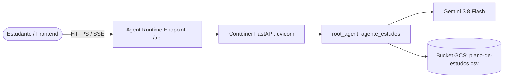

# Guia de Implementação Futura: Deploy no Vertex AI Agent Runtime

Este documento explica, de ponta a ponta e de forma didática, como realizar o **deployment** do `agente-estudos` no **Agent Runtime** (antigo Vertex AI Reasoning Engine) do Google Cloud utilizando o `agents-cli`.

> [!NOTE]
> **Planejamento Futuro:** Este documento serve como roteiro arquitetural e prático para quando a equipe decidir levar o agente do ambiente local (Cloud Shell/ADK Web) para a nuvem de produção gerenciada. **Nenhuma alteração de infraestrutura ou código foi executada neste momento.**

---

## 1. O que é o Vertex AI Agent Runtime?

O **Agent Runtime** é o serviço serverless totalmente gerenciado do Google Cloud projetado especificamente para hospedar e escalar agentes do Google ADK e Gemini.

### Principais vantagens:
* **Totalmente Gerenciado (Serverless):** Não é necessário gerenciar servidores, clusters Kubernetes ou instâncias virtuais. O Agent Runtime escala de zero até o volume necessário e cobra apenas pelo tempo de execução de vCPU e memória (não há custo quando ocioso).
* **Autenticação e Segurança Nativas:** Integração direta com o IAM do Google Cloud e com o **Agent Identity** (identidade nativa do agente para acessar recursos como o Google Cloud Storage e APIs de LLM).
* **Pass-Through de API Unificado:** Expõe automaticamente as rotas HTTP do agente (SSE para streaming de respostas, A2A para comunicação entre agentes e Reasoning Engine contract) através de endpoints seguros protegidos pelo Google Cloud.
* **Persistência de Sessões:** Permite utilizar o `VertexAiSessionService` para que as conversas do estudante persistam automaticamente entre diferentes chamadas.



---

## 2. Decisões de Arquitetura para o Deploy (Grill-Me Checklist)

Quando for o momento de executar o deploy, as seguintes decisões deverão ser consideradas:

### Decisão 1: Identidade do Agente (Autenticação)
* **Recomendada:** Usar **Agent Identity** (padrão atual do Agent Runtime). O Google Cloud cria automaticamente uma identidade para o agente.
* **Alternativa:** Criar uma Service Account dedicada (`agente-estudos-sa@PROJECT_ID.iam.gserviceaccount.com`) via Terraform e atribuí-la ao agente.

### Decisão 2: Permissões IAM (Role Grants)
Para que o agente funcione no Agent Runtime e salve a agenda no GCS, sua identidade precisará de:
1. `roles/aiplatform.user`: para chamar os modelos Gemini.
2. `roles/storage.objectUser` (ou `roles/storage.admin`): com acesso específico ao bucket `GCS_BUCKET_NAME`.
3. `roles/logging.logWriter`: para exportar logs estruturados para o Cloud Logging.

### Decisão 3: Região do Agent Runtime
* O projeto está configurado para a região `us-east1` no `agents-cli-manifest.yaml`.
* O bucket GCS deve preferencialmente residir na mesma região (`us-east1`) para menor latência e evitar custos de transferência de rede entre regiões.

### Decisão 4: Persistência de Sessões
* **Dev/Testes:** `session_type: in_memory` (as sessões reiniciam quando o contêiner recicla).
* **Produção:** `session_type: vertex_ai` (as sessões ficam salvas na infraestrutura de sessões do Vertex AI, permitindo histórico contínuo).

---

## 3. Passo a Passo Técnico de Como Implementar

### Passo 1: Habilitar as APIs do Google Cloud
No projeto do GCP (`GOOGLE_CLOUD_PROJECT`), habilitar os serviços necessários:
```bash
gcloud services enable \
    aiplatform.googleapis.com \
    storage.googleapis.com \
    artifactregistry.googleapis.com \
    cloudbuild.googleapis.com \
    logging.googleapis.com
```

---

### Passo 2: Habilitar o Target no Projeto com `agents-cli`
Atualmente, o arquivo `agente-estudos/agents-cli-manifest.yaml` possui `deployment_target: none`.

Para adicionar os arquivos de infraestrutura e configurar o Agent Runtime, roda-se o comando de *enhancement*:
```bash
cd agente-estudos
agents-cli scaffold enhance . --deployment-target agent_runtime
```
*O que esse comando faz?*
* Atualiza o `agents-cli-manifest.yaml` para `deployment_target: agent_runtime`.
* Gera a estrutura de Terraform em `deployment/terraform/` configurada com o recurso `google_vertex_ai_reasoning_engine`.
* Prepara o arquivo de manifesto e scripts auxiliares.

---

### Passo 3: Criar o Bucket GCS de Produção
Criar o bucket oficial no Cloud Storage:
```bash
gcloud storage buckets create gs://agente-estudos-planos-prod \
    --location=us-east1 \
    --uniform-bucket-level-access
```

---

### Passo 4: Configurar Variáveis de Ambiente no Deploy
O `agent.py` lê as seguintes variáveis:
* `MODEL`: ex. `gemini-3.8-flash`
* `GCS_BUCKET_NAME`: ex. `agente-estudos-planos-prod`

No Agent Runtime, essas variáveis podem ser passadas durante o comando `deploy` ou configuradas no arquivo `agents-cli-manifest.yaml` / Terraform:
```bash
agents-cli deploy \
    --project=$GOOGLE_CLOUD_PROJECT \
    --region=us-east1 \
    --env-var MODEL=gemini-3.8-flash \
    --env-var GCS_BUCKET_NAME=agente-estudos-planos-prod
```

---

### Passo 5: Executar o Deploy
Para realizar o build da imagem Docker no Cloud Build e registrá-la no Agent Runtime:
```bash
cd agente-estudos
agents-cli deploy
```

> [!TIP]
> **Tempo de Deploy:**
> O primeiro deploy no Agent Runtime costuma levar entre 5 e 10 minutos para compilar a imagem de contêiner e instanciar o serviço na nuvem.
> Se a sessão do terminal atingir o timeout, o deploy continuará rodando no servidor. É possível acompanhar o status com:
> ```bash
> agents-cli deploy --status
> ```

---

### Passo 6: Conceder Acesso ao Bucket GCS para a Identidade do Agente
Após o deploy, o Agent Runtime gera a identidade do agente. Concede-se a permissão de leitura e escrita no bucket:
```bash
# Obtém a conta de serviço / identidade do agente gerada
SA_EMAIL=$(gcloud ai reasoning-engines list --region=us-east1 --format="value(serviceAccount)")

# Concede permissão no bucket GCS
gcloud storage buckets add-iam-policy-binding gs://agente-estudos-planos-prod \
    --member="serviceAccount:${SA_EMAIL}" \
    --role="roles/storage.objectUser"
```

---

### Passo 7: Testar o Agente em Produção
Após a conclusão, o `agents-cli deploy` gerará o arquivo `deployment_metadata.json` contendo o ID do recurso (`projects/.../locations/us-east1/reasoningEngines/...`).

Para testar a invocação direta do agente na nuvem:
```bash
agents-cli run "Quero planejar meus estudos de Python"
```

Ou via chamada HTTP autenticada utilizando a rota de passthrough `/api`:
```bash
TOKEN=$(gcloud auth print-access-token)
ENGINE_URL="https://us-east1-aiplatform.googleapis.com/reasoningEngines/v1/{RESOURCE_ID}/api/run_sse"

curl -X POST "$ENGINE_URL" \
     -H "Authorization: Bearer $TOKEN" \
     -H "Content-Type: application/json" \
     -d '{"app_name": "app", "user_id": "usuario_teste", "message": "Quero aprender Python em 2 semanas"}'
```

---

## 4. Checklist de Validação Final do Deploy

- [ ] Todas as APIs necessárias estão habilitadas no projeto GCP.
- [ ] O bucket GCS foi criado e a identidade do agente possui `roles/storage.objectUser`.
- [ ] O comando `agents-cli deploy` concluiu com sucesso e gerou `deployment_metadata.json`.
- [ ] O gating continua funcionando na nuvem (o agente pede os dados faltantes).
- [ ] O agente grava com sucesso o arquivo `plano-de-estudos.csv` no bucket GCS e exibe a confirmação.
