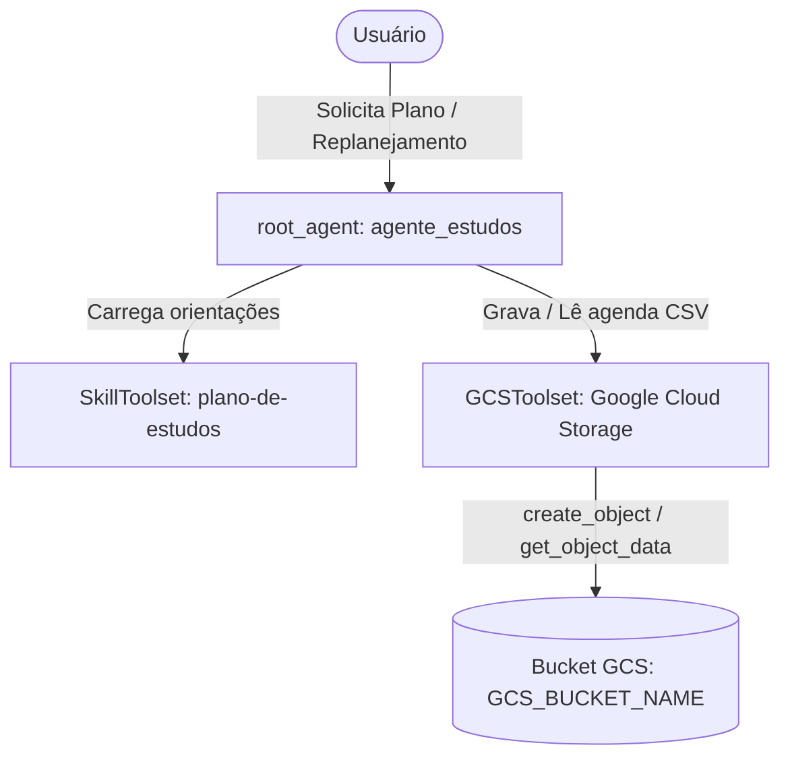

# Substituição do EnvironmentToolset pelo GCSToolset

## Objetivo
Substituir o `EnvironmentToolset` (que grava e lê arquivos em sistema de arquivos local através de `LocalEnvironment`) pelo `GCSToolset` oficial do Google ADK ([adk.dev/integrations/gcs](https://adk.dev/integrations/gcs/)). Isso permite que o `agente-estudos` armazene e recupere a agenda em formato CSV (`plano-de-estudos.csv`) diretamente em um bucket do Google Cloud Storage (GCS) usando as ferramentas `create_object` e `get_object_data`.



---

## User Review Required

> [!IMPORTANT]
> **Definição do Bucket do GCS:**
> O `GCSToolset` requer o nome de um bucket GCS para salvar e recuperar objetos. Vamos configurar uma variável de ambiente `GCS_BUCKET_NAME` no arquivo `.env` (com padrão `agente-estudos-planos`).
> Se você já possuir um bucket GCS específico criado no seu projeto GCP (`land-of-pleasure-513722`), informe-o ou configure a variável `GCS_BUCKET_NAME` no `.env`. Caso o bucket ainda não exista no GCP, o agente tentará salvar nele gerando erro na API caso não tenha sido criado previamente.

> [!NOTE]
> **Autenticação GCS:**
> O `GCSToolset` utiliza `GCSCredentialsConfig` integrado ao Application Default Credentials (ADC) do Google Cloud (`google.auth.default()`). No Cloud Shell, o ADC já está ativo e configurado por padrão.

---

## Open Questions

1. Você já possui um bucket GCS criado ou deseja que o padrão seja configurável via `GCS_BUCKET_NAME` (com fallback para `agente-estudos-planos`)?
   *(Nossa recomendação é ler `os.environ.get("GCS_BUCKET_NAME", "agente-estudos-planos")` e instruir o agente a utilizá-lo).*

---

## Proposed Changes

### Componente: Agente ADK (`agente-estudos/app/agent.py`)

Substituir o `FerramentasDeArquivo` (baseado em `EnvironmentToolset` e `LocalEnvironment`) pelo `GCSToolset`:
- Importar `GCSToolset` e `GCSCredentialsConfig` de `google.adk.integrations.gcs`.
- Importar `GCSToolSettings` e `Capabilities` de `google.adk.integrations.gcs.settings`.
- Configurar credenciais ADC via `google.auth.default()` de forma resiliente.
- Filtrar as ferramentas para expor `create_object` e `get_object_data`.
- Atualizar `get_instruction` para injetar o nome do bucket e orientar o modelo sobre as ferramentas GCS.

#### [MODIFY] `agente-estudos/app/agent.py`

```python
import datetime
import os
from pathlib import Path

import google.auth
from google.adk.agents import Agent
from google.adk.agents.readonly_context import ReadonlyContext
from google.adk.apps import App
from google.adk.integrations.gcs import GCSCredentialsConfig, GCSToolset
from google.adk.integrations.gcs.settings import Capabilities, GCSToolSettings
from google.adk.models import Gemini
from google.adk.skills import load_skill_from_dir
from google.adk.tools.skill_toolset import SkillToolset
from google.genai import types

MODEL = os.environ.get("MODEL", "gemini-3.8-flash")
GCS_BUCKET_NAME = os.environ.get("GCS_BUCKET_NAME", "agente-estudos-planos")

BASE_DIR = Path(__file__).resolve().parent
SKILLS_DIR = BASE_DIR / "skills" / "plano-de-estudos"


def get_instruction(context: ReadonlyContext | None = None) -> str:
    hoje = datetime.date.today()
    data_formatada = hoje.strftime("%Y-%m-%d")
    dia_semana = hoje.strftime("%A")
    return (
        f"A data de hoje é {data_formatada} ({dia_semana}).\n"
        "Você é um mentor especialista em estudos. Você ajuda estudantes a organizarem sua rotina e a criarem planos de estudo personalizados, "
        "com técnicas eficientes de aprendizagem, cronograma realista e exportação para calendário.\n"
        "Utilize a skill 'plano-de-estudos' e siga estritamente o seu fluxo de trabalho e as regras de gating.\n"
        f"Para manipular arquivos de agenda no Google Cloud Storage (GCS), utilize o bucket '{GCS_BUCKET_NAME}' e o objeto 'plano-de-estudos.csv'. "
        "Use a ferramenta 'create_object' (com bucket_name, object_name e data) para gravar o CSV e 'get_object_data' se precisar inspecionar a versão anterior."
    )


skill_plano = load_skill_from_dir(SKILLS_DIR)
skill_toolset = SkillToolset(skills=[skill_plano])

try:
    credentials, _ = google.auth.default()
    credentials_config = GCSCredentialsConfig(credentials=credentials)
except Exception:
    credentials_config = None

gcs_toolset = GCSToolset(
    credentials_config=credentials_config,
    gcs_tool_settings=GCSToolSettings(capabilities=[Capabilities.READ_WRITE]),
    tool_filter=["create_object", "get_object_data"],
)

root_agent = Agent(
    name="agente_estudos",
    model=Gemini(
        model=MODEL,
        retry_options=types.HttpRetryOptions(attempts=3),
    ),
    instruction=get_instruction,
    tools=[skill_toolset, gcs_toolset],
)

app = App(
    root_agent=root_agent,
    name="app",
)
```

---

### Componente: Configuração de Ambiente (`agente-estudos/.env` e `.env.example`)

Adicionar a variável `GCS_BUCKET_NAME`:

#### [MODIFY] `agente-estudos/.env`
Adicionar linha:
```env
GCS_BUCKET_NAME=agente-estudos-planos
```

#### [MODIFY] `agente-estudos/.env.example`
Adicionar linha:
```env
GCS_BUCKET_NAME=your-gcs-bucket-name
```

---

### Componente: Skills de Plano de Estudos (`skills/` e `agente-estudos/app/skills/`)

Atualizar a documentação e orientações da skill para refletir o uso do `GCSToolset` e das ferramentas `create_object` e `get_object_data` em vez de `WriteFile` e `ReadFile`. Mantendo as duas pastas sincronizadas.

#### [MODIFY] `skills/plano-de-estudos/SKILL.md` e `agente-estudos/app/skills/plano-de-estudos/SKILL.md`
- Substituir menções a `WriteFile` por `create_object`.

#### [MODIFY] `skills/plano-de-estudos/references/salvar_agenda.md` e `agente-estudos/app/skills/plano-de-estudos/references/salvar_agenda.md`
- Atualizar cabeçalho: `# Salvar a Agenda no Google Cloud Storage (GCSToolset)`.
- Tabela de ferramentas:
  - `create_object`: bucket_name (texto), object_name (texto), data (conteúdo CSV).
  - `get_object_data`: bucket_name (texto), object_name (texto).
- Ajustar exemplos de chamada e interpretação de respostas (`status`: `SUCCESS`, etc.).

#### [MODIFY] `skills/plano-de-estudos/references/workflow.md` e `agente-estudos/app/skills/plano-de-estudos/references/workflow.md`
- Atualizar Passo 5 para indicar chamada a `create_object` com o bucket e objeto `plano-de-estudos.csv`.

#### [MODIFY] `skills/plano-de-estudos/assets/plano_template.md` e `agente-estudos/app/skills/plano-de-estudos/assets/plano_template.md`
- Atualizar seção 5 do template: `📁 Salvei a agenda no bucket [bucket] como [objeto], com [N] sessões.`

---

### Componente: Testes Unitários (`agente-estudos/tests/unit/test_agent_config.py`)

Atualizar a suíte de testes unitários para validar a nova configuração do `GCSToolset`:
- Verificar que `GCSToolset` está presente em `root_agent.tools`.
- Verificar que o `tool_filter` contém apenas `{"create_object", "get_object_data"}`.
- Testar execução de `create_object` e `get_object_data` com mock de `google.cloud.storage.Client` (garantindo execução rápida e independente de conexão externa ou existência prévia do bucket no teste unitário).

#### [MODIFY] `agente-estudos/tests/unit/test_agent_config.py`

---

### Componente: Documentação do Projeto (`AGENTS.md` e `README.md`)

#### [MODIFY] `AGENTS.md`
- Atualizar seção do Toolset para `GCSToolset` ([adk.dev/integrations/gcs](https://adk.dev/integrations/gcs/)).
- Atualizar itens de `Done-when` e constraints.

---

## Verification Plan

### Automated Tests
1. Executar os testes unitários com pytest:
   ```bash
   cd agente-estudos
   uv run pytest tests/unit -v
   ```
2. Executar linter/formatação se aplicável:
   ```bash
   cd agente-estudos
   uv run ruff check .
   ```

### Manual Verification
1. Iniciar o servidor web ADK localmente para conferir inicialização limpa:
   ```bash
   cd agente-estudos
   uv run adk web --allow_origins="*"
   ```
2. No Web UI do ADK:
   - Enviar mensagem inicial ("Quero organizar meus estudos de JavaScript.") e validar o gating.
   - Fornecer os dados completos e conferir no log de eventos a chamada a `create_object` com `bucket_name`, `object_name="plano-de-estudos.csv"` e `data`.
